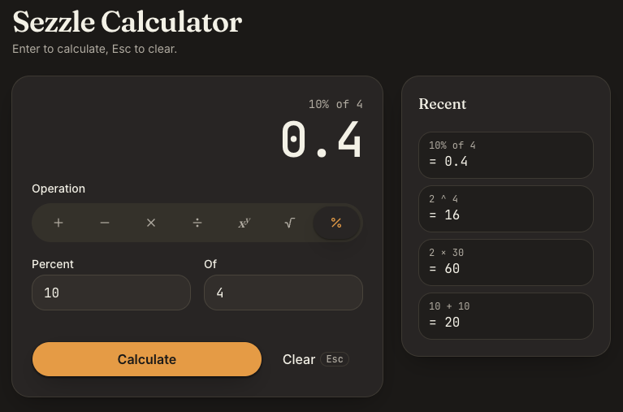

# Sezzle Calculator

[](https://github.com/ranonbezerra/sezzle-calculator/actions/workflows/ci.yml)

A full-stack calculator: a Go REST API that does the arithmetic and a React single-page app
that collects input, calls the API and formats the result.



- [Overview](#overview)
- [Prerequisites](#prerequisites)
- [Quick start with Docker](#quick-start-with-docker)
- [Run locally](#run-locally)
- [Tests and coverage](#tests-and-coverage)
- [API reference](#api-reference)
- [Design decisions](#design-decisions)
- [Assumptions and intended behaviors](#assumptions-and-intended-behaviors)
- [Optional items](#optional-items)
- [Process](#process)
- [What I would do next](#what-i-would-do-next)

## Overview

Seven operations: add, subtract, multiply, divide, power, square root and percentage.
The backend computes every result; the frontend only validates input and formats what the API returns.

| Part | Stack |
| --- | --- |
| Backend ([backend/](backend/)) | Go 1.27, standard library only (`net/http`, `encoding/json`, `log/slog`), golangci-lint v2 |
| Frontend ([frontend/](frontend/)) | React 19, TypeScript, Vite, Tailwind CSS, shadcn/ui, Vitest + Testing Library, oxlint |
| Delivery | Docker multi-stage images, docker-compose, GitHub Actions CI |

```
Docker (make docker-up)

  browser ──> nginx  (frontend container, published on :3000)
               ├── /                  static SPA built by Vite
               └── /api/*, /healthz ──> Go API (backend container :8080, not published)

Development (make backend-run + make frontend-run)

  browser ──> Vite dev server (:5173)
               ├── /                  SPA with hot reload
               └── /api/*         ──> Go API (:8080)
```

The browser only ever talks to one origin, so there is no CORS configuration.

## Prerequisites

- Go 1.27 (the exact version is in [backend/go.mod](backend/go.mod))
- Node 22 ([frontend/.nvmrc](frontend/.nvmrc)); `nvm use` inside `frontend/` picks it up
- Docker with Compose v2, for the containerized setup
- golangci-lint v2, only for `make backend-lint` / `make lint` (CI uses v2.15.0)
- curl 7.82 or newer for the `--json` flag used in the API examples

## Quick start with Docker

```sh
make docker-up      # docker compose up --build
```

Open http://localhost:3000. `make docker-down` stops the stack.

Compose starts the frontend only once the backend's healthcheck passes, and both containers
report healthy, so `docker compose up -d --wait` returns when the app is ready to use.

## Run locally

Backend, on http://localhost:8080 (set `PORT` to change it):

```sh
make backend-run
```

Frontend, in a second terminal, on http://localhost:5173 (Vite proxies `/api` to the backend):

```sh
cd frontend && npm ci && cd ..   # first time only
make frontend-run
```

## Tests and coverage

```sh
make test              # Go tests (with -race) and Vitest
make lint              # go vet + golangci-lint, oxlint + tsc
make backend-cover     # Go tests with a per-function coverage summary
make frontend-cover    # Vitest with coverage
make coverage-report   # both, then regenerates the summaries in docs/coverage/
```

Committed summaries, regenerated by `make coverage-report`:
- Backend: per-function coverage in [docs/coverage/backend/summary.txt](docs/coverage/backend/summary.txt)
- Frontend: per-file table in [docs/coverage/frontend/summary.txt](docs/coverage/frontend/summary.txt)

The full HTML reports are not committed: CI uploads them on every run as the `backend-coverage`
and `frontend-coverage` artifacts, and `make backend-cover` / `make frontend-cover` produce them
locally (`go tool cover -html=backend/coverage.out`, `frontend/coverage/index.html`).

Current numbers:

| Area | Statements | Branches | Functions | Lines |
| --- | --- | --- | --- | --- |
| backend `internal/calculator` | 100% | – | – | – |
| backend `internal/httpapi` | 100% | – | – | – |
| backend `cmd/server` | 54.3% (100% outside `main` and `fatal`) | – | – | – |
| **backend total** | **85.5%** | – | – | – |
| frontend `src/App.tsx` | 100% | 100% | 100% | 100% |
| frontend `src/api` | 100% | 100% | 100% | 100% |
| frontend `src/components` | 100% | 100% | 100% | 100% |
| frontend `src/hooks` | 100% | 100% | 100% | 100% |
| frontend `src/lib` | 100% | 90.9% | 100% | 100% |
| **frontend total** | **100%** | **98.05%** | **100%** | **100%** |

Go reports statement coverage only. Notes:
- `main` and `fatal` in `cmd/server` are untested by design: `main` only wires the tested pieces
  (`loadConfig`, `newServer`, `run`, `healthcheck`) together, and `fatal` calls `os.Exit`.
- The two uncovered frontend branches are the `b ?? 0` fallbacks in `formatExpression`
  ([format.ts:34-36](frontend/src/lib/format.ts#L34-L36)); binary operations always carry `b`.
- `src/components/ui` is vendored shadcn/ui code and is excluded from coverage, along with
  `src/main.tsx` and the test setup.

## API reference

The full contract, with schemas and every error code, is in [docs/openapi.yaml](docs/openapi.yaml) (OpenAPI 3.1).

| Method | Path | Body | Success |
| --- | --- | --- | --- |
| `POST` | `/api/v1/{operation}` | `{"a": number, "b": number}`; `sqrt` takes only `"a"` | `200 {"operation": "...", "result": number}` |
| `GET`, `HEAD` | `/healthz` | – | `200 {"status": "ok"}` |

Operations: `add`, `subtract`, `multiply`, `divide`, `power`, `sqrt`, `percentage`
(`percentage(a, b)` is a percent of b, `a * b / 100`).

Every response is `application/json`. Errors share one shape, and clients should branch on `code`:

```json
{"error": {"code": "snake_case_code", "message": "human-readable text"}}
```

| Status | Codes | When |
| --- | --- | --- |
| 400 | `invalid_json` | malformed, empty or non-object body, unknown field, trailing data |
| 400 | `invalid_number` | an operand is not a number, or is outside the float64 range (e.g. `1e309`) |
| 400 | `missing_operand` | `a` or (for binary operations) `b` is absent or `null` |
| 400 | `unexpected_operand` | `b` sent to `sqrt` |
| 404 | `unknown_operation` | the operation name is not one of the seven (checked before the body) |
| 404 | `not_found` | no route matches the path |
| 405 | `method_not_allowed` | wrong method on a known path; the `Allow` header lists the right one |
| 413 | `request_too_large` | body over 1024 bytes |
| 422 | `division_by_zero`, `negative_sqrt`, `non_finite_result` | valid input with no finite real result |
| 500 | `internal_error` | an unexpected error; not reachable through the current operations |

### Examples

These were run against `make backend-run`; the output is pasted unedited. `-w 'HTTP %{http_code}\n'`
prints the status after the body. Against the Docker stack, use `localhost:3000` instead of `localhost:8080`.

Health:

```console
$ curl -s -w 'HTTP %{http_code}\n' localhost:8080/healthz
{"status":"ok"}
HTTP 200
```

Every operation:

```console
$ curl -s -w 'HTTP %{http_code}\n' --json '{"a": 2, "b": 3}' localhost:8080/api/v1/add
{"operation":"add","result":5}
HTTP 200

$ curl -s -w 'HTTP %{http_code}\n' --json '{"a": 10, "b": 4.5}' localhost:8080/api/v1/subtract
{"operation":"subtract","result":5.5}
HTTP 200

$ curl -s -w 'HTTP %{http_code}\n' --json '{"a": -6, "b": 7}' localhost:8080/api/v1/multiply
{"operation":"multiply","result":-42}
HTTP 200

$ curl -s -w 'HTTP %{http_code}\n' --json '{"a": 1, "b": 3}' localhost:8080/api/v1/divide
{"operation":"divide","result":0.3333333333333333}
HTTP 200

$ curl -s -w 'HTTP %{http_code}\n' --json '{"a": 2, "b": 10}' localhost:8080/api/v1/power
{"operation":"power","result":1024}
HTTP 200

$ curl -s -w 'HTTP %{http_code}\n' --json '{"a": 81}' localhost:8080/api/v1/sqrt
{"operation":"sqrt","result":9}
HTTP 200

$ curl -s -w 'HTTP %{http_code}\n' --json '{"a": 10, "b": 30}' localhost:8080/api/v1/percentage
{"operation":"percentage","result":3}
HTTP 200
```

Raw float64 results and `-0` normalization:

```console
$ curl -s -w 'HTTP %{http_code}\n' --json '{"a": 0.1, "b": 0.2}' localhost:8080/api/v1/add
{"operation":"add","result":0.30000000000000004}
HTTP 200

$ curl -s -w 'HTTP %{http_code}\n' --json '{"a": -1, "b": 0}' localhost:8080/api/v1/multiply
{"operation":"multiply","result":0}
HTTP 200
```

400, invalid input:

```console
$ curl -s -w 'HTTP %{http_code}\n' --json '{"a": 2,' localhost:8080/api/v1/add
{"error":{"code":"invalid_json","message":"invalid JSON body: unexpected EOF"}}
HTTP 400

$ curl -s -w 'HTTP %{http_code}\n' --json '{"a": 2, "b": 3, "c": 4}' localhost:8080/api/v1/add
{"error":{"code":"invalid_json","message":"invalid JSON body: unknown field \"c\""}}
HTTP 400

$ curl -s -w 'HTTP %{http_code}\n' --json '{"a": "2", "b": 3}' localhost:8080/api/v1/add
{"error":{"code":"invalid_number","message":"field \"a\" must be a finite number"}}
HTTP 400

$ curl -s -w 'HTTP %{http_code}\n' --json '{"a": 1e309, "b": 1}' localhost:8080/api/v1/add
{"error":{"code":"invalid_number","message":"field \"a\" must be a finite number"}}
HTTP 400

$ curl -s -w 'HTTP %{http_code}\n' --json '{"a": 2}' localhost:8080/api/v1/add
{"error":{"code":"missing_operand","message":"field \"b\" is required"}}
HTTP 400

$ curl -s -w 'HTTP %{http_code}\n' --json '{"a": 81, "b": 2}' localhost:8080/api/v1/sqrt
{"error":{"code":"unexpected_operand","message":"this operation takes only \"a\""}}
HTTP 400
```

404, 405 and 413:

```console
$ curl -s -w 'HTTP %{http_code}\n' --json '{"a": 7, "b": 2}' localhost:8080/api/v1/modulo
{"error":{"code":"unknown_operation","message":"unknown operation \"modulo\""}}
HTTP 404

$ curl -s -w 'HTTP %{http_code}\n' localhost:8080/foo
{"error":{"code":"not_found","message":"no route for /foo"}}
HTTP 404

$ curl -s -w 'HTTP %{http_code}\n' localhost:8080/api/v1/add
{"error":{"code":"method_not_allowed","message":"method GET is not allowed, use POST"}}
HTTP 405

$ curl -s -w 'HTTP %{http_code}\n' -X POST localhost:8080/healthz
{"error":{"code":"method_not_allowed","message":"method POST is not allowed, use GET, HEAD"}}
HTTP 405

$ # a valid body padded with 1100 spaces, 1116 bytes in total
$ printf '{"a": 1, "b": 2%1100s}' '' | curl -s -w 'HTTP %{http_code}\n' --json @- localhost:8080/api/v1/add
{"error":{"code":"request_too_large","message":"request body must not exceed 1024 bytes"}}
HTTP 413
```

422, math errors:

```console
$ curl -s -w 'HTTP %{http_code}\n' --json '{"a": 1, "b": 0}' localhost:8080/api/v1/divide
{"error":{"code":"division_by_zero","message":"division by zero"}}
HTTP 422

$ curl -s -w 'HTTP %{http_code}\n' --json '{"a": -4}' localhost:8080/api/v1/sqrt
{"error":{"code":"negative_sqrt","message":"square root of a negative number"}}
HTTP 422

$ curl -s -w 'HTTP %{http_code}\n' --json '{"a": 1e308, "b": 10}' localhost:8080/api/v1/multiply
{"error":{"code":"non_finite_result","message":"result is not a finite number"}}
HTTP 422

$ curl -s -w 'HTTP %{http_code}\n' --json '{"a": -8, "b": 0.333}' localhost:8080/api/v1/power
{"error":{"code":"non_finite_result","message":"result is not a finite number"}}
HTTP 422
```

`internal_error` (500) has no example: every error the calculator returns maps to a 4xx code,
so the 500 path is only covered by a unit test.

## Design decisions

**Backend**
- **Go standard library only.** Go 1.22+ `ServeMux` patterns (`POST /api/v1/{operation}`) cover
  routing, `log/slog` covers request logging, so a framework would add dependencies without
  removing code.
- **One endpoint per operation**, `POST /api/v1/{operation}`, resolved through a lookup table in
  the calculator package that also holds each operation's arity. The HTTP layer has no switch over
  operation names, and an unknown name is a 404 like any unknown resource.
- **Error model.** One JSON shape for every error, with a stable `code` and a free-form `message`.
  Status codes separate who has to act: 400 the request is malformed, 404 no such operation or
  route, 405 wrong method, 413 body too large, 422 the input is valid but has no finite result,
  500 a server bug. `ServeMux`'s plain-text 404 and 405 are replaced with JSON handlers.
- **float64 throughout.** NaN and ±Inf results (overflow, `power(-8, 0.333)`) become
  `non_finite_result` (422) instead of invalid JSON. `-0` is normalized to `0`, because JSON would
  otherwise carry `-0` to the client.
- **Raw floats in the API, formatting in the UI.** The API returns the exact float64
  (`0.30000000000000004`); the UI rounds to 12 significant digits (`0.3`) and switches to
  exponent notation from 1e12 up and below 1e-6. Clients that want full precision keep it.
- **Percentage is "a percent of b"**, computed as `a * b / 100` rather than `a / 100 * b`:
  dividing last keeps common values exact (`7` percent of `300` is `21`, where `7 / 100 * 300`
  gives `21.000000000000004`). The cost is that `a * b` can overflow when the true result is
  still finite, which only happens near the float64 limit (`1e300` percent of `1e10`) and is
  reported as `non_finite_result`, never as a wrong number.
- **Strict input.** Operands decode into `*float64`, so a missing field is distinguishable from
  `0`. `DisallowUnknownFields` and a trailing-data check reject anything but a single object
  with `a` and `b`.
- **1 KB body limit** with `http.MaxBytesReader`: a valid request is a few dozen bytes.
- **Timeouts** on both sides: the server sets read-header (2 s), read (5 s), write (10 s) and idle
  (60 s) timeouts and shuts down gracefully on SIGINT/SIGTERM; the client aborts after 5 s.

**Frontend**
- **Same-origin proxy instead of CORS.** Vite proxies `/api` in development and nginx proxies
  `/api` and `/healthz` in Docker, so the API never needs CORS headers and the client uses
  relative URLs.
- **A form, not a keypad.** Two labeled inputs and an operation picker map one-to-one to the API
  request and work with the keyboard and screen readers. Labels change per operation
  (Base / Exponent, Percent / Of, Dividend / Divisor, a single Number for square root), which
  makes "a percent of b" readable without help text.
- **Results come only from the backend.** The client parses input to validate it but never
  computes a result.
- **History reuse works like a calculator's ANS.** Clicking one of the last five results fills the
  first operand and moves focus to the second input, or to Calculate for square root, so
  "click, type, Enter" chains calculations.
- **Typed API client that never throws.** `calculate()` returns a discriminated union. Failures
  are split by meaning: `network_error` when the server could not be reached (fetch rejected,
  timeout, non-JSON body such as a proxy's HTML 502) and `unexpected_response` when it answered
  outside the contract (wrong shape, unknown error code). Each code maps to a friendly message.
- **Tailwind CSS + shadcn/ui**: accessible Radix primitives copied into the repo, only the
  components the UI uses, no runtime component library. Fonts are self-hosted, so the app makes
  no external requests.
- **oxlint**, the create-vite default, for linting; `tsc` covers type checking.

**Delivery**
- **Backend image**: static binary on `gcr.io/distroless/static:nonroot` (about 16 MB, no shell,
  runs as non-root). Distroless has no curl, so the binary has a `-healthcheck` flag that GETs its
  own `/healthz` and exits 0 or 1; Compose uses it as the healthcheck.
- **Frontend image**: Vite build served by `nginxinc/nginx-unprivileged:1.30.6-alpine` (pinned,
  non-root), with SPA fallback, immutable caching for hashed assets and `no-cache` for
  `index.html`. Its healthcheck uses `127.0.0.1` instead of `localhost`, because busybox `wget`
  resolves `localhost` to `::1` and nginx listens on IPv4 only.
- **Pinned toolchains.** Go comes from `go.mod` (the Dockerfile sets `GOTOOLCHAIN=local`, so a
  mismatch fails the build), Node from `.nvmrc` (the Dockerfile checks the major version), and
  golangci-lint and the nginx image use exact versions. CI reads the same files.

## Assumptions and intended behaviors

- After an error, the display keeps the last successful result and the error message appears
  above Calculate, in a live region.
- Clear (or Esc) empties the inputs and the current result. A request that was already sent still
  shows its answer when it arrives. While a request is pending, Esc does nothing; the Clear button
  still works.
- The frontend validates input before sending and disables Calculate while it is invalid, so input
  errors such as `invalid_number` or `missing_operand` mainly matter to direct API clients.
- Input accepts an optional sign, a decimal point and scientific notation (`-1.5`, `.5`, `2e3`);
  a comma as decimal separator is rejected.
- `ServeMux` answers non-canonical paths such as `/api//v1/add` with a 301 redirect that has no
  JSON body.

## Optional items

All implemented: power, square root, percentage, and Docker (backend and frontend images plus
docker-compose, built and smoke-tested in CI).

## Process

- One GitHub issue per change, one branch and one PR per issue, squash-merged into `main`.
- CI ([.github/workflows/ci.yml](.github/workflows/ci.yml)) runs on every PR and push to `main`:
  backend (vet, golangci-lint, tests with coverage), frontend (oxlint, typecheck, tests with
  coverage), then a Docker job that builds both images, starts the stack and calls the API through
  nginx.
- Issues and PRs share one number sequence on GitHub: issues #1 to #7 and bug #13, PRs #8 to #15
  (#13 being the bug issue, fixed in #15).
- AI usage: planning in a Claude chat, implementation with Claude Code, every change reviewed,
  tested and committed by me. Every prompt and the decisions made along the way are in
  [docs/PROMPTS.md](docs/PROMPTS.md).

## What I would do next

- End-to-end tests with Playwright against the Docker stack (keyboard flow, history reuse, errors).
- Let the user choose which operand a history entry fills.
- Decimal arithmetic for exact results (`0.1 + 0.2 = 0.3` in the API too), e.g. a decimal type
  over strings in the request.
- Locale-aware decimal input (`1,5`) and number formatting.

Time spent: about 3.5 hours, including planning, implementation, reviews and documentation.
